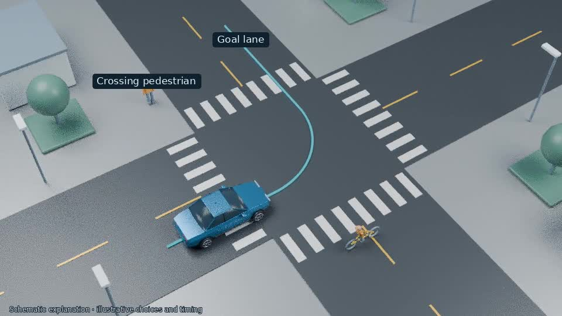

# Complete Tesla planning explainer

## [Watch / download the full 5-minute 10-second video](tesla-planning-complete.mp4)

All 13 chapters are assembled. The preferred narrator is retained, with no music or burned-in narration captions. The remaining chapters include lower street and follow cameras, a front-wheel detail, frontal technical views and a hardware workbench.

This is a schematic explanation of published Tesla patent application US20260105614A1. The original generic props are not manufacturer CAD, and the graphics are not a reconstruction or benchmark of Tesla software. The application does not prove HW3/V14 parity, an 80% measured saving or deployment.

Export: 960×540, 30 fps, H.264/AAC; the approved opening was rendered at640×360 and upscaled. Media checks pass. Final inspection used decoded frame sequences across the whole film, additional checks of the repaired section, frozen-voice timing and audio-level checks. Subjective audiovisual judgment remains for the viewer.

## Project files

- [Master project JSON](tesla-project.json?raw=true)
- [Colab source and media package](tesla-colab-package.zip?raw=true)
- [Colab notebook](Tesla_Explainer_Colab.ipynb)
- [Full storyboard](tesla-full-storyboard.md)
- [Sources, description and chapter times](tesla-video-description.md)

The package now includes all 13 completed chapters and frozen narration. Local package, source-hash, notebook-syntax and CPU smoke checks pass; actual Colab/GPU execution has not been tested here. The Colab adapter reuses checked clips and leaves new outputs subject to their own final review. Nothing has been uploaded to YouTube.

If GitHub does not play the video, select **Download raw file**.
