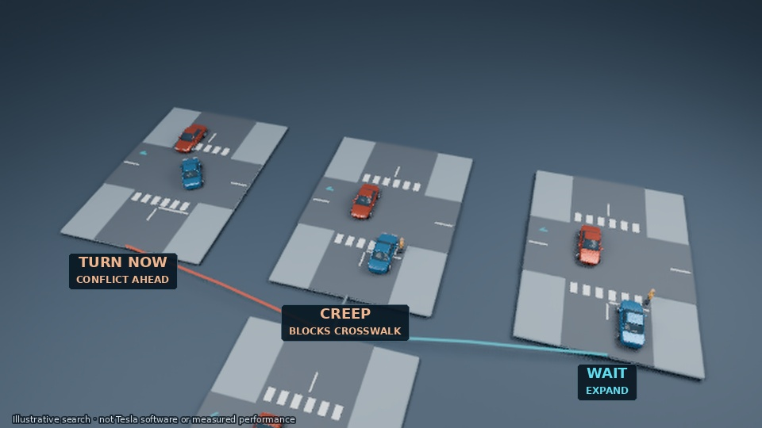

# Tesla opening — moving 3D search

## [Watch the 15-second opening](tesla-opening-v2.mp4)

This starts the film at 00:00. The preferred narrator B returns at approximately 178 words per minute. A car approaches a junction; three moving miniature traffic worlds show possible choices. Poor branches are removed, and the retained branch develops further choices.

Original 3D vehicle and roads, four camera setups, rolling wheels, moving traffic and a pedestrian. No held-image sections, narration captions or music. Preview-resolution rendering is upscaled to 960×540; this is a direction review, not the full film.

The miniatures and rankings illustrate the idea, not Tesla's actual software or scores. The narration refers to published patent application US20260105614A1; it makes no HW3/V14, measured savings or deployment promise.

**Reply in chat: Send to work pool, or Reject with changes. Nothing queues automatically.**

[Opening narration, storyboard and evidence](tesla-opening-review.md) · [Previous voice pace test](tesla-paced-v4.mp4) · [Full draft storyboard](tesla-storyboard.md)

If GitHub does not play the clip, use **Download raw file**.
