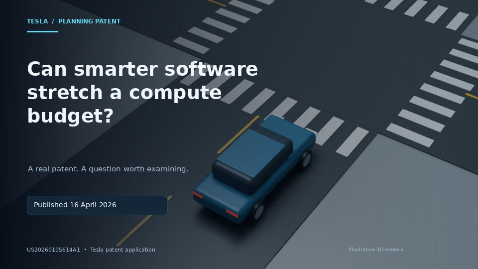

# Tesla patent video — first preview

**[Watch the 33-second narrated preview](tesla-patent-preview.mp4)** · **[Read the revised full storyboard](tesla-storyboard.md)**

## Your decision

After watching, reply in the chat with **Send to work pool** or **Reject** and the changes you want. This GitHub page does not queue anything automatically. The remaining full-video chapters are not yet rendered.

This previews the first chapter: an original illustrative 3D EV, a generic compute module, and timed technical graphics. They are not exact Tesla CAD or a reconstruction of Tesla's deployed software. No music or burned-in narration captions.

The verified patent supports graph-based planning, scoring and pruning. This video does not claim it proves HW3/V14 feature parity or an 80% measured saving.

### Primary sources

- [Tesla patent application US20260105614A1](https://patents.google.com/patent/US20260105614A1/en)
- [Tesla FSD (Supervised) support documentation](https://www.tesla.com/support/fsd)

If the video does not play in GitHub, use **Download raw file**. The [self-contained browser viewer](tesla-viewer.html) can also be downloaded, then opened locally; GitHub displays its HTML source rather than hosting it as a page.

### Earlier engine tests

- [3D piston cutaway](piston-cutaway-test.mp4)
- [Branching-path workflow test](path-selection-test.mp4)
