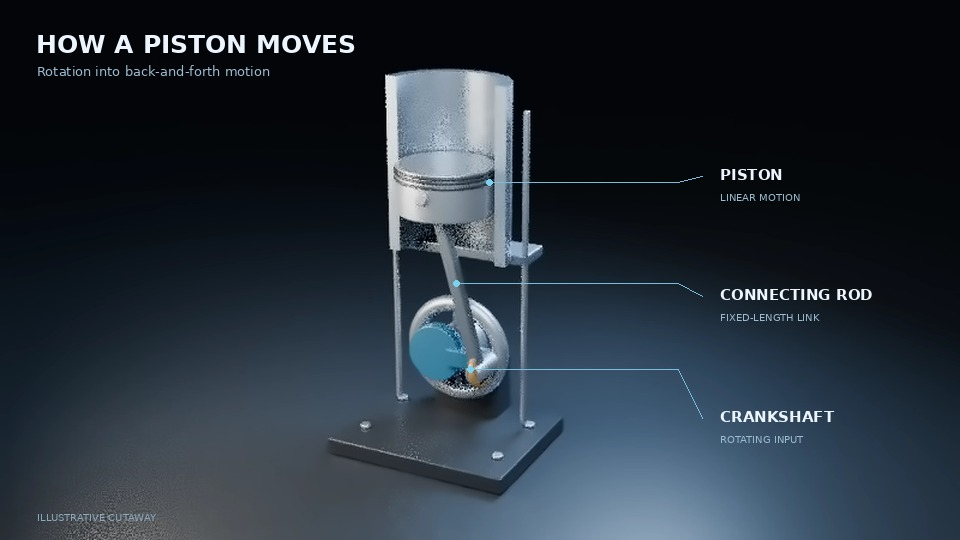

# 3D explainer preview

## How a piston moves — six-second test

**[Open the video](piston-cutaway-test.mp4)** · **[View looping animation without audio](piston-test.gif)**

The MP4 includes narration and a restrained mechanical sound. If GitHub does not play it, use its Download raw file button. An optional self-contained [browser viewer](piston-viewer.html) can be downloaded with the same button, then opened locally; it has native Play/Pause controls and needs no server. GitHub shows HTML source rather than running the viewer in its repository browser.

This is a visual-quality pilot: a physically sectioned hollow cylinder, piston, fixed-length connecting rod and rotating crankshaft, with tracked explanatory labels. Original procedural geometry; no downloaded model assets. Kinematics, frame bounds, video/audio format, duration, loudness and clipping were checked. It is an ideal illustrative mechanism, without combustion, valves, lubrication or force simulation.

The previous [branching-path workflow test](path-selection-test.mp4) remains available.
