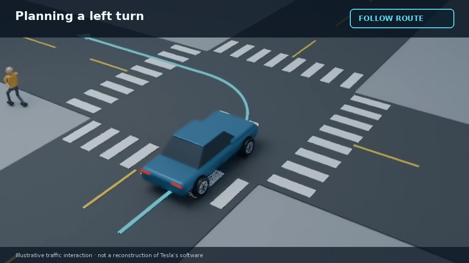

# Tesla video — continuous 3D direction preview

## [Watch the 18-second continuous 3D preview](tesla-dynamic-3d-v3.mp4)

**Voice B is confirmed. No static-image sections.** This short illustrative excerpt tests the updated visual direction before the full film.

A pedestrian crosses, an oncoming car passes, and the blue vehicle yields before following a left-turn route. Wheels roll and steer, the pedestrian is animated, and four actual 3D camera shots follow the action. The road/actors/camera are rendered for every frame; these are not held pictures with pan/zoom effects. Technical labels support the moving scene; there are no burned-in narration captions or music.

This is a low-resolution direction draft with original generic props, not exact Tesla CAD, a real vehicle test or a reconstruction of Tesla software. Modeled actor-envelope separation, main-actor framing and video/audio checks passed; this is not real-world safety validation.

## Your choice

Reply in the chat: **Send to work pool** or **Reject with changes**. Nothing queues automatically. Work-pool approval accepts this direction; the remaining full-film chapters and production-quality preflight still need completion.

[Updated full storyboard](tesla-storyboard.md)

If GitHub does not play the video, use **Download raw file**.

### Earlier revisions

[Earlier motion/voice A](tesla-preview-v2-A.mp4) · [Earlier motion/voice B](tesla-preview-v2-B.mp4) · [Piston motion reference](piston-cutaway-test.mp4)

Sources: [Tesla patent US20260105614A1](https://patents.google.com/patent/US20260105614A1/en) and [Tesla FSD support](https://www.tesla.com/support/fsd). The full film will retain the verified-patent framing without unsupported HW3 feature-parity or 80% performance promises.
