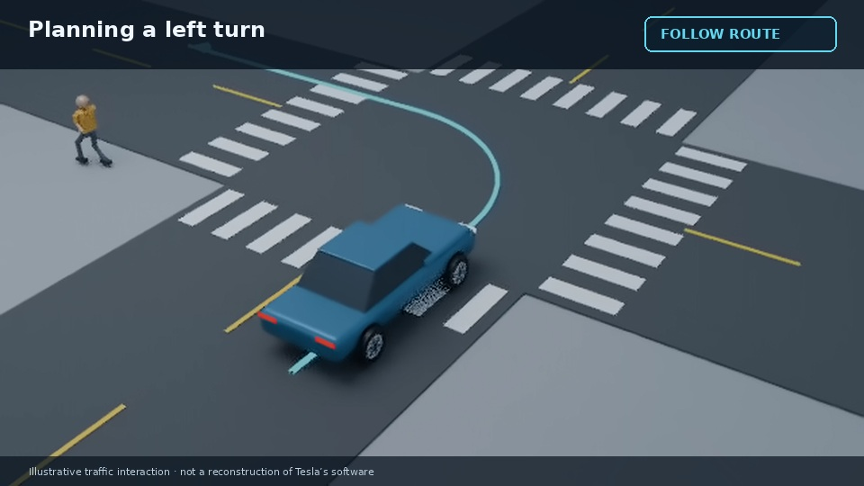

# Tesla preview — voice B, restored pace

## [Watch the revised 12-second preview](tesla-paced-v4.mp4)

Same narrator B, with direct spoken phrasing and measured delivery of approximately **179 words per minute**. The prior slow take was approximately 126. The new take was synthesized at the intended pace; recorded speech was not time-stretched to fill a slot.

The 3D edit is tighter, using native-speed shots of crossing traffic, the yield, the left turn and the exit. No held-image sections, slide cards or music. This is an illustrative direction test with original generic geometry, not a Tesla driving-policy reconstruction.

**Reply in the chat: Send to work pool, or Reject with changes. Nothing queues automatically.**

[Full storyboard](tesla-storyboard.md) · [Previous slower 3D take](tesla-dynamic-3d-v3.mp4) · [Original preferred voice B audition](tesla-preview-v2-B.mp4)

If GitHub does not play the clip, use **Download raw file**.
