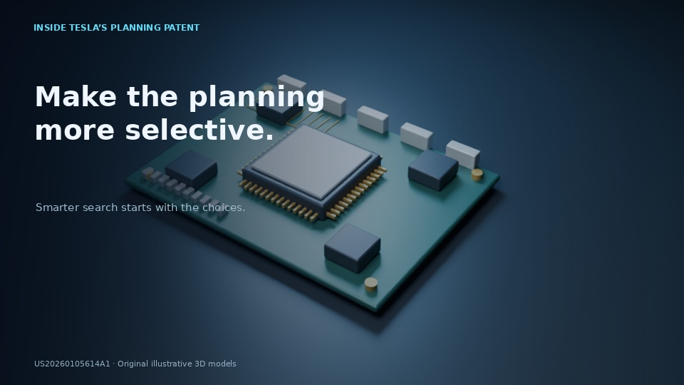

# Tesla preview — revised movement and narration

## Compare the voices

- **[Version A — current narrator, conversational rewrite](tesla-preview-v2-A.mp4)** — about 29 seconds.
- **[Version B — alternative narrator, adjusted pace](tesla-preview-v2-B.mp4)** — about 25 seconds.

Both use the same words and visual sequence, paced to the actual reading. The writing uses contractions and more natural spoken phrasing. No music or narration subtitles. Neither changes the channel narrator automatically.

## Visual revision

Eight shorter directed shots: moving EV, camera pushes, an original stylized patent card, a genuine 3D exploded chip reveal, growing candidate paths, changing example scores, and removal of low-score branches. Scores are illustrative, not Tesla performance measurements.

**Reply in the chat with A, B, or the changes you want. Nothing has been sent to the work pool.**

If GitHub does not play a clip, use **Download raw file**.

[Revised full storyboard](tesla-storyboard.md) · [Earlier rejected preview](tesla-patent-preview.mp4) · [3D piston test](piston-cutaway-test.mp4)

Sources: [Tesla patent application US20260105614A1](https://patents.google.com/patent/US20260105614A1/en) and [Tesla FSD support](https://www.tesla.com/support/fsd). These are original illustrative props, not exact Tesla CAD. No HW3 feature-parity or 80% performance promise is asserted.
