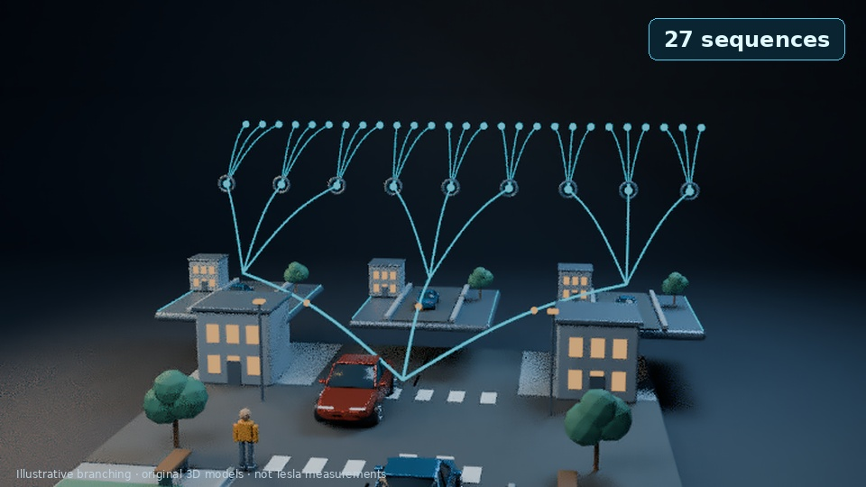

# Retention audit and richer 3D revision proposal

[Watch / download the nine-second direction sample](richer-3d-retention-sample.mp4) · [QA and inspection scope](richer-3d-retention-qa.json)

The new sample replaces a bare graph floor with a cutaway neighborhood and three miniature future worlds. It uses native animated geometry, a closer street camera, two purposeful reveals and count badges timed to measured narration groups. The preferred narrator is retained at about 176 wpm, with no speech time stretching, music or narration captions. Technical source qualifiers and count labels are present. All geometry is original and schematic, not Tesla CAD, implementation data or measured performance. The output is 960×540 at 30 fps, rendered natively at 768×432 then denoised and scaled. This tests one micro hook and payoff, not a whole new film. Subjective sound and style remain for the viewer to judge.

## Audit result

The delivered first film has an opening hook and useful teaching rewards, but it lacks an explicit, enforced hook/value/reward ladder. Its formal introduction slows the early explanation, the full worked situation comes late, and recurring sparse diagram modes need richer cause-and-effect staging. No audience-retention analytics are available. Structural checks do not demonstrate watch-time gains.

- [Detailed audit, with timestamps](tesla-retention-audit.md)
- [Rewritten eight-step script and visual/audio directions](tesla-retention-revision.md)
- [Machine-readable draft](tesla-retention-draft.json)
- [Structural planning check](tesla-retention-structural-check.json)
- [Small engine source checkpoint](retention-engine-update.zip?raw=true) · [Checksum](retention-engine-update.sha256)

The draft is roughly 3:29 by word-rate estimate and has not been voiced, approved or rendered as a complete episode. Its first reward is estimated around 10 seconds and its longest declared value gap is about 32 seconds; these are planning figures, not measured delivery or viewer behavior. The full-production gate correctly blocks this estimated draft.

The source checkpoint includes new retention checks, bibles, draft and procedural sources; all 83 unit tests pass both locally and after extraction. It contains no media or voice weights and is not a ready-to-upload replacement for the original Colab package. Use a fresh revision workspace; copying changed source over a frozen production snapshot invalidates its fingerprints and reviews. Actual Colab/GPU execution has not been tested here.

The [delivered v1 movie](tesla-planning-complete.mp4), master JSON and Colab ZIP remain unchanged. Nothing has been uploaded to YouTube. If GitHub does not play the sample, choose **Download raw file**.
