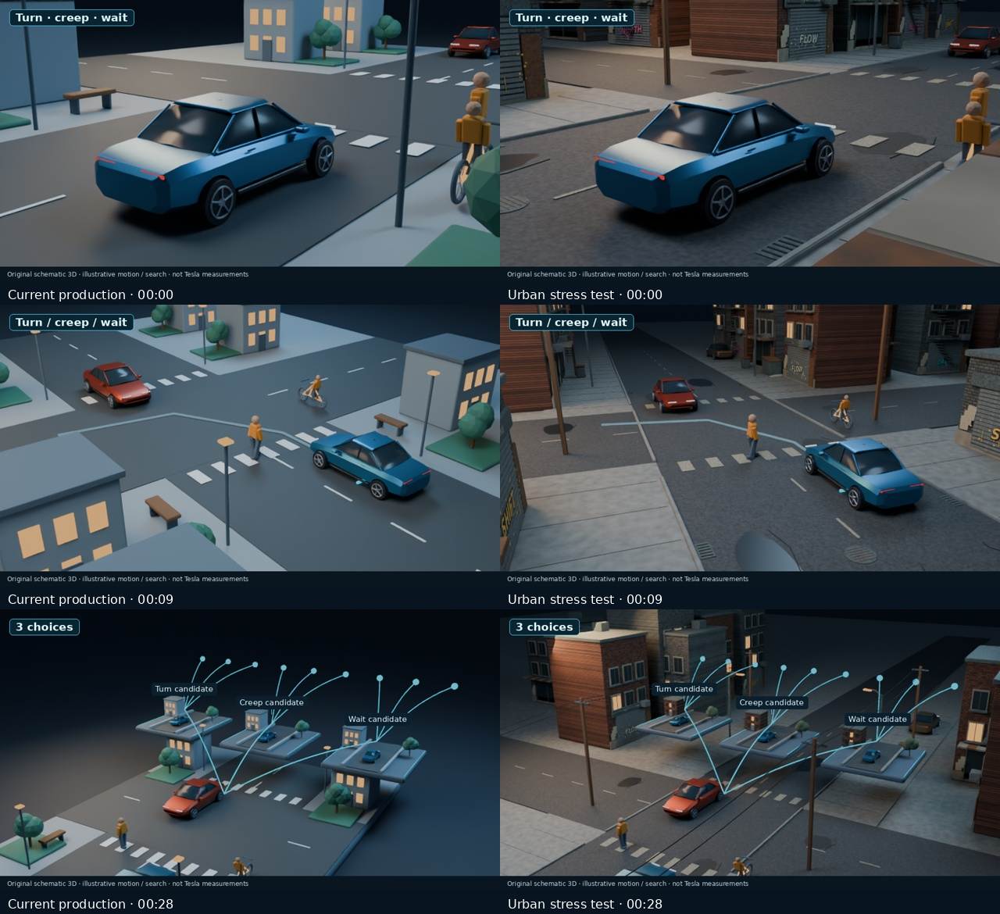

# Gritty urban environment — moving preview

## [▶ PLAY THE 8-SECOND VIDEO (MP4)](tesla-urban-grit-moving-peek-8s.mp4)

This is actual continuously rendered 3D footage from 00:00–00:08, with the same opening script and narration. The full 30-second environment test is still rendering. The main Tesla production continues separately.

The excerpt has passing media checks and decoded-image inspection. It uses 240 native frames at 30fps; the 376 copied AAC audio packets match the delivered opening. No new narration, music or narration captions.

[Render activity for both jobs](tesla-v2-render-progress.md) · [Preview QA](tesla-urban-grit-moving-peek-8s-qa.json)

Optional still-frame comparison with the original setting

Left: current production. Right: the urban experiment at the same script moments.

The urban set adds original procedural graffiti, weathered brick storefronts, shutters, fire escapes, patched asphalt, drains and utility wires. Camera placement was adapted to keep the traffic and explanation clear. User approval of the new art direction remains pending; no YouTube upload has been performed.
