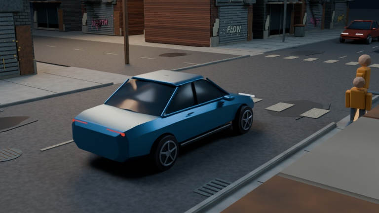

# Urban environment stress test — first look

**These are corrected 3D stills. The new 30-second moving preview is rendering and is not ready yet.** Status snapshot: October 26, 2026, 11:50 PM EDT.

Same opening script and narration; a separate original urban set. The completed test will use the delivered opening's exact AAC audio. The main Tesla production continues independently.

The test adds worn brick storefronts, tagged shutters, original wall lettering and spray details, fire escapes, utility wires, patched asphalt, faded crossings, drains, damp road scars and restrained street clutter. Camera placement was adapted to keep the car and crossing readable in the denser streets.

Eleven native diagnostic images were inspected. Initial pole/roof obstructions, graffiti placement and primary framing were corrected; 14 sampled hero/pedestrian sightlines pass. The moving output still needs its own full excerpt inspection. This is an art-direction experiment, not approval to replace the full film's style.

## Current look versus urban test

Left: current production. Right: urban test at the same script moments.

## Opening frame — new environment

[Main render activity indicator](tesla-v2-render-progress.md) · [Existing 30-second progress peeks](tesla-v2-sneak-peeks.md)

All new set geometry and graphics are original procedural work, with DejaVu lettering. Generic schematic vehicles; no manufacturer CAD or Tesla implementation/benchmark data. Nothing has been uploaded to YouTube.
