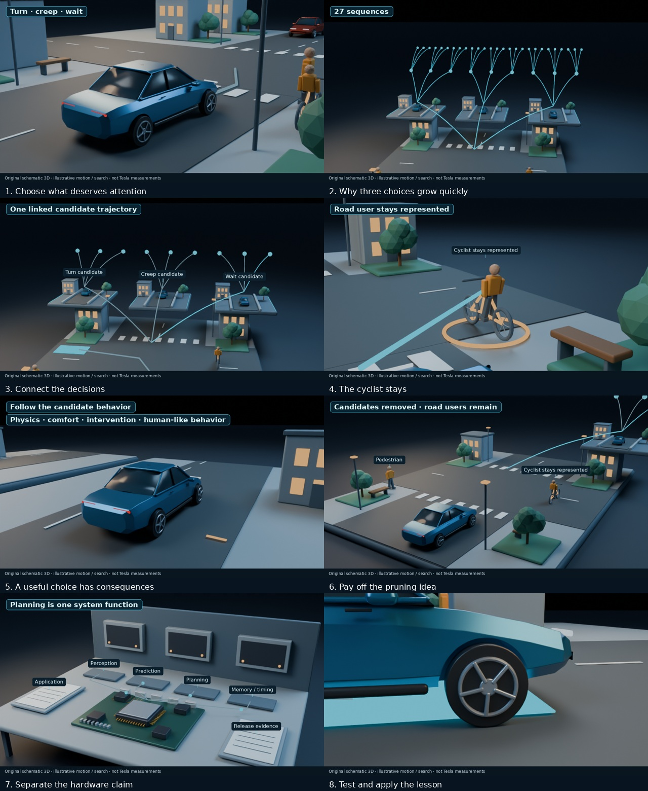

# Tesla v2 — full production running

Status snapshot: October 26, 2026, 09:32 PM EDT. **The new full film is rendering. It is not finished or finally inspected yet.** This page is a checkpoint, not a live progress meter.

The second audit is complete. The production version has measured narration of 3 minutes 28 seconds, eight question/payoff sections and 6239 native 3D frames. The preferred voice is retained near 178–184 wpm, with no time stretching, music or narration captions.

Improvements include clearer early viewer value, layered street/future/workbench scenes, actual motion comparisons in place of arbitrary score bars, plain-language factor callouts, camera reveals tied to spoken ideas, cyclist sightline repairs, and a final wheel detail/follow shot. The native render is 768×432 at 30 fps, exported at 960×540. All props are original schematic models, not Tesla CAD or software/benchmark data.

Seventy native diagnostic images were inspected; every source pose passed primary framing/traffic checks, and all 274 sampled cyclist teaching-view sightlines are clear. All 86 unit tests pass. The full render, mixed-audio QA, complete encoded-film inspection and final release are still pending. The CPU render is a multi-hour stage; its time does not represent AI API generation. No YouTube upload is scheduled.

- [Second audit](tesla-v2-audit.md)
- [Measured production storyboard](tesla-v2-storyboard.md)
- [Master project JSON checkpoint](tesla-v2-project.json?raw=true)
- [Matching v2 Colab/source/frozen-voice package](tesla-colab-v2.zip?raw=true) · [checksum](tesla-colab-v2.sha256)
- [V2 notebook](Tesla_Explainer_v2_Colab.ipynb)

This ZIP is a production snapshot, not the finished movie. It includes frozen narration and procedural sources, with any checked completed clips available at snapshot time. It excludes native frame caches and voice weights. Local extraction, file hashes, relocated production/retention gates, all 86 tests and a tiny CPU device render pass. Actual Colab/GPU execution remains untested. Use the v2 notebook with the v2 ZIP in a fresh workspace. The old v1 movie, JSON and Colab package are preserved.

## Scene design board — preflight stills

These are stills from the eight animated sets, not a replacement video or evidence of a completed film.

The patent is disclosure, not evidence of HW3/V14 feature parity, rollout or eighty-percent savings. No audience-retention increase has been measured.

[View the timestamped render activity indicator](tesla-v2-render-progress.md).
